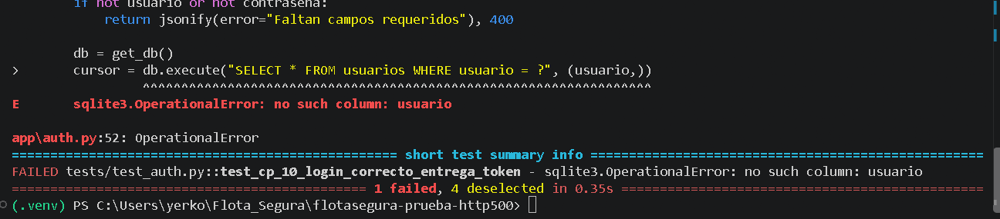
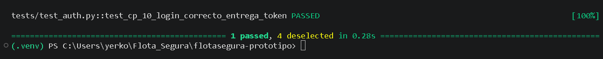

# Bitácora de defectos

Responsable de mantenerla: Integrante F. Cada integrante anota los defectos que encuentre en sus pruebas.

La rúbrica pide al menos 3 defectos **reales**, encontrados al ejecutar las pruebas. Aquí solo se registra lo que efectivamente falló. Ver el procedimiento en `REPARTO.md`.

Severidad: `Crítica` (compromete seguridad o datos), `Alta` (el módulo entrega un resultado incorrecto), `Media`, `Baja`.

## Resumen

| ID | Prueba que lo detectó | Descripción | Causa | Severidad | Commit con la falla | Commit de la corrección | Nueva ejecución |
|---|---|---|---|---|---|---|---|
| DEF-01 |  |  |  |  |  |  |  |

## Detalle por defecto

Copiar este bloque por cada defecto.

### DEF-01 — título

- **Prueba que lo detectó:** CP-XX
- **Descripción:** qué se esperaba y qué ocurrió.
- **Causa:** por qué ocurrió.
- **Severidad:**
- **Evidencia de la falla:** `docs/evidencias/CP-XX_falla.png`

**Código antes**

```python
```

**Código después**

```python
```

- **Evidencia de la nueva ejecución:** `docs/evidencias/CP-XX_pasa.png`
- **Control ISO 27000 relacionado** (solo si es un defecto de seguridad): control, y riesgo al que responde.
# Bitácora de Defectos - Proyecto FlotaSegura

Este documento registra los defectos encontrados durante el ciclo de pruebas unitarias e integración, siguiendo las directrices de trazabilidad del proyecto.

---
# Bitácora de Defectos — Módulo de Alertas (Patrón Observer)

* **Responsable / Integrante:** Michael Rabelo (Integrante B)
* **Módulo:** `app/alertas.py` (Patrón Observer)

### DEF-01: Incompatibilidad en columnas de inserción y restricciones de Llaves Foráneas (FK) en la tabla `alertas`

- **Fecha de Detección**: Octubre de 2026
- **Pruebas Asociadas**: `test_cp_06_al_cruzar_umbral_se_alerta_a_jefe_y_conductor`, `test_cp_07_camion_sin_conductor_solo_alerta_al_jefe`
- **Severidad**: Alta (Bloqueaba el pipeline de integración continua en GitHub Actions)

#### 1. Descripción del Problema (Fallo)
Al ejecutar inicialmente el conjunto de pruebas para el servicio de alertas (`app/alertas.py`), el servidor de pruebas (`pytest`) arrojó múltiples errores de integridad en SQLite:
1. `sqlite3.OperationalError: table alertas has no column named tipo`
2. `sqlite3.IntegrityError: NOT NULL constraint failed: alertas.plan_id` / `destinatario_id` / `nivel`
3. `sqlite3.IntegrityError: FOREIGN KEY constraint failed`

#### 2. Causa Raíz
- **Desalineación con el Esquema**: La implementación inicial de los métodos `actualizar` en los notificadores (`NotificadorJefeFlota` y `NotificadorConductor`) realizaba consultas `INSERT` incompletas que omitían campos obligatorios exigidos por el contrato de la base de datos (`plan_id`, `destinatario_id`, `nivel`).
- **Restricciones de Integridad Referencial**: Las pruebas enviaban IDs simulados que no existían previamente en las tablas relacionales del entorno de prueba (`usuarios`, `camiones`, `planes_mantencion`), lo que activaba los bloqueos por *Foreign Key*.

#### 3. Solución Aplicada y Código de Cambio
- **Código ANTES:**
  ```python
  # Inserción fija y parcial que omitía llaves y campos requeridos
  cursor.execute(
      "INSERT INTO alertas (camion_id, mensaje) VALUES (?, ?)",
      (camion['id'], mensaje)
  )
- **Código DESPUES:**
  # Inserción completa parametrizada respetando el esquema relacional
  cursor.execute(
      "INSERT INTO alertas (camion_id, plan_id, destinatario_id, nivel, mensaje) VALUES (?,?,?,?,?)",
      (camion['id'], plan_mantencion.plan_id, jefe_id, plan_mantencion.estado, mensaje)
  )
  
#### 4. Verificación y Estado
- **Estado**: Resuelto y Verificado.
- **Evidencia**: Tras la corrección y el reenvío de los cambios al repositorio remoto, todas las pruebas unitarias asociadas al Patrón Observer (`CP-06`, `CP-07`, `CP-08`, `CP-09`) completaron su ejecución con éxito, obteniendo el estado de compilación aprobada en GitHub Actions.

#### 5. Evidencias
* **Prueba Fallando:**
  
* **Prueba Pasando (Verde):**
  
---

### DEF-RF9-01 — Error HTTP 500 en POST /login

**Responsable:** Yerko Morales
**Módulo:** Autenticación RF9
**Prueba asociada:** CP-10
**Severidad:** Alta
**Estado:** Corregido y validado

#### 1. Descripción del defecto

Durante la integración del módulo de autenticación RF9, el equipo detectó que el endpoint `POST /login` respondía HTTP 500, impidiendo el inicio de sesión con credenciales válidas.

#### 2. Causa raíz


La implementación original consultaba la columna `usuario` y utilizaba `contrasena`, campos que no existen en la tabla `usuarios` del esquema SQLite oficial.

Los campos correctos son `nombre_usuario` y `hash_contrasena`.

Al reproducir la consulta defectuosa en una base SQLite temporal se obtuvo:

`sqlite3.OperationalError: no such column: usuario`

Esta reproducción confirma la incompatibilidad entre la consulta SQL y la estructura de la base de datos.


#### 3. Código antes de la corrección

Archivo: `app/auth.py`

La implementación original utilizaba una consulta SQL incompatible con el esquema oficial de SQLite.

```python
db = get_db()
cursor = db.execute(
    "SELECT * FROM usuarios WHERE usuario = ?",
    (usuario,)
)
user = cursor.fetchone()
```

**Error reproducido:**

```text
sqlite3.OperationalError: no such column: usuario
```

#### 4. Código después de la corrección

Archivo: `app/auth.py`

Se reemplazó la consulta SQL defectuosa por la función `buscar_usuario_por_nombre()` de `app/repositorio.py`, permitiendo consultar las columnas correspondientes al esquema oficial.

```python
registro = buscar_usuario_por_nombre(usuario.strip())

if registro is None or not verificar_contrasena(
    registro["hash_contrasena"], contrasena
):
    return jsonify(error="Credenciales inválidas"), 401

token = crear_token(registro["id"], registro["rol"])

return jsonify(token=token, rol=registro["rol"]), 200
```

#### 5. Evidencias de ejecución CP-10

**Antes de la corrección — FAILED**

Prueba CP-10 reproducida de forma controlada utilizando el código del commit histórico `475dad6` y la prueba automatizada de la versión corregida.

Resultado: `FAILED` debido a `sqlite3.OperationalError: no such column: usuario`.



**Después de la corrección — PASSED**

Prueba CP-10 ejecutada sobre la implementación corregida del módulo RF9.

Resultado: `1 passed, 4 deselected`.


