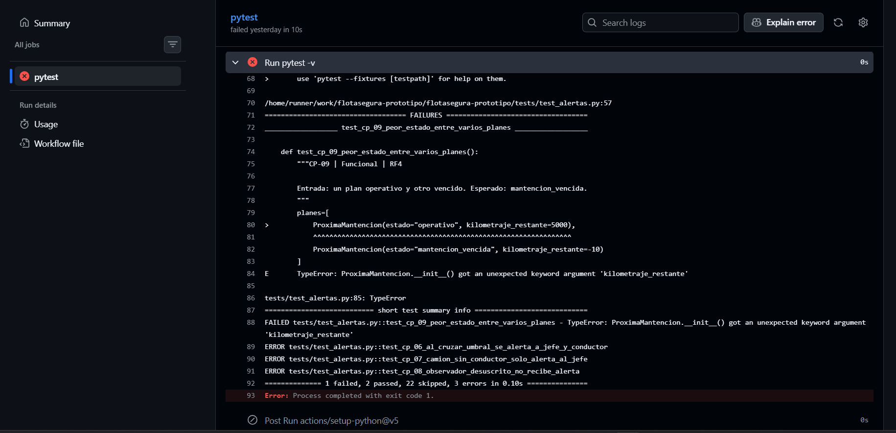
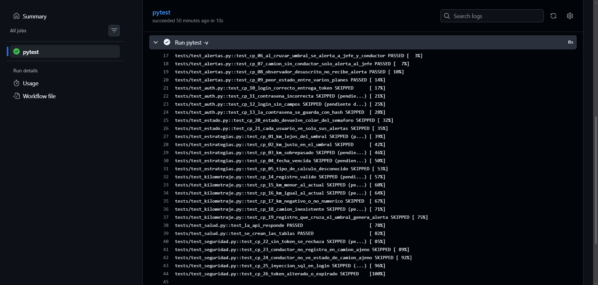

# Bitácora de defectos

Registro de los defectos reales encontrados al ejecutar las pruebas del prototipo, con su causa, el código antes y después de la corrección y la evidencia de la nueva ejecución.

Mantenida por el Integrante F (Bryan Martinez). Restaurada y consolidada por Felipe Aravena el 13-10-2026, después de que tres subidas distintas dejaran el archivo con marcas de conflicto o secciones perdidas (ver `docs/registro_incidencias.md`). Cada defecto lo documenta quien lo corrigió.

Severidad: `Crítica` (compromete seguridad o datos), `Alta` (el módulo entrega un resultado incorrecto o no funciona), `Media`, `Baja`.

## Resumen

| ID | Prueba que lo detectó | Descripción | Causa | Severidad | Estado | Documentado por |
|---|---|---|---|---|---|---|
| DEF-01 | CP-06, CP-07 | Las inserciones en la tabla `alertas` omitían columnas obligatorias y violaban llaves foráneas | Consulta `INSERT` incompleta respecto del esquema; datos de prueba sin las filas relacionadas | Alta | Corregido y verificado (CP-06 a CP-09 pasan) | Michael Rabelo |
| DEF-02 | CP-06 | `NotificadorJefeFlota` enviaba la alerta a un destinatario fijo (`destinatario_id = 1`) en lugar de buscar a los usuarios con rol `jefe_flota` | Id del jefe de flota escrito en el código en vez de consultarse en la tabla `usuarios` | Media | Corregido y verificado (CP-06 pasa; commit `50bd340`) | Michael Rabelo |
| DEF-RF9-01 | CP-10 | `POST /login` respondía HTTP 500 con cualquier credencial | La consulta usaba las columnas `usuario` y `contrasena`, que no existen (`nombre_usuario`, `hash_contrasena`) | Alta | Corregido y verificado (CP-10 a CP-13 y CP-25 pasan) | Yerko Morales |
| DEF-D1 a DEF-D4 | CP-31 a CP-34 | Defectos de validación de entradas y tolerancia a fallos en el registro de kilometraje (id fuera de rango, token de usuario inexistente, cuerpo demasiado grande, falla de un notificador) | Entradas no validadas (rango del id, tamaño del cuerpo), token aceptado sin comprobar que el usuario exista, y notificación sin manejo de errores | Media a Alta | Corregidos y verificados (CP-31 a CP-34 pasan) | Widjy Marcellus (corrección junto con Michael Rabelo) |

## Controles ISO/IEC 27001 vinculados a las correcciones de seguridad

Numeración del Anexo A de ISO/IEC 27001:2013. Selección inicial de Bryan Martinez; completada por Felipe Aravena.

| Control | Defecto | Riesgo al que responde |
|---|---|---|
| **A.9.4.2 — Procedimientos seguros de inicio de sesión** | DEF-RF9-01 | Mientras el login respondía 500, ningún usuario podía autenticarse y el error exponía detalles internos en el registro del servidor. La corrección deja un único mensaje para usuario inexistente y contraseña incorrecta, valida los campos de entrada y no revela cuál de los dos falló. |
| **A.9.4.1 — Restricción del acceso a la información** | DEF-D2 (token firmado de un usuario que ya no existe) | Un token válido podía seguir usándose después de eliminar al usuario. La corrección en `app/permisos.py` verifica que el usuario del token exista en la base antes de autorizar, y responde 401 si no. |
| **A.14.2.5 — Principios de ingeniería de sistemas seguros** | DEF-D1 y DEF-D3 (id fuera de rango, cuerpo mayor a 1 MB) | Entradas no validadas provocaban errores 500 o permitían agotar recursos del servidor. Las correcciones en `app/rutas_kilometraje.py` validan rango y tamaño antes de procesar, y responden 404 y 413. |

## Detalle por defecto

### Defectos del módulo de alertas (Integrante B)

* **Responsable / Integrante:** Michael Rabelo (Integrante B). Sección reescrita por Michael el 13-10-2026 (commit `df4864f`) para separar DEF-01 y DEF-02; reintegrada sobre la versión consolidada por Felipe Aravena el mismo día.
* **Módulo:** `app/alertas.py` (Patrón Observer)

| ID | Módulo / Componente | Descripción resumida | Severidad | Estado |
|---|---|---|---|---|
| **DEF-01** | `app/alertas.py` | Incompatibilidad de columnas y llaves foráneas en la inserción de `alertas` | Alta | Resuelto |
| **DEF-02** | `app/alertas.py` | Destinatario con id fijo (`1`) en `NotificadorJefeFlota` | Media | Resuelto |

### DEF-01: Incompatibilidad en columnas de inserción y restricciones de llaves foráneas (FK) en la tabla `alertas`

- **Fecha de detección:** 8 y 9 de octubre de 2026
- **Pruebas asociadas:** `test_cp_06_al_cruzar_umbral_se_alerta_a_jefe_y_conductor`, `test_cp_07_camion_sin_conductor_solo_alerta_al_jefe`
- **Severidad:** Alta (bloqueaba la ejecución del pipeline en GitHub Actions)

#### 1. Descripción del problema (fallo)
Al ejecutar el conjunto de pruebas del servicio de alertas (`app/alertas.py`), `pytest` arrojó errores de integridad de SQLite en secuencia: `table alertas has no column named tipo`, `NOT NULL constraint failed: alertas.plan_id` (y luego `destinatario_id` y `nivel`) y `FOREIGN KEY constraint failed`.

#### 2. Causa raíz
- **Desalineación con el esquema:** la implementación inicial de `actualizar` en los notificadores hacía consultas `INSERT` incompletas que omitían campos obligatorios del contrato de la base de datos (`plan_id`, `destinatario_id`, `nivel`).
- **Integridad referencial:** las pruebas enviaban ids que no existían en `usuarios`, `camiones` y `planes_mantencion`, lo que activaba los bloqueos por llave foránea.

#### 3. Código antes
```python
# Inserción parcial e incompleta que omitía campos requeridos por la tabla
cursor.execute(
    "INSERT INTO alertas (camion_id, mensaje) VALUES (?, ?)",
    (camion['id'], mensaje)
)
```

#### 4. Código después (commits del 09-10-2026)
```python
# Inserción parametrizada que incluye todas las columnas obligatorias del esquema relacional
cursor.execute(
    "INSERT INTO alertas (camion_id, plan_id, destinatario_id, nivel, mensaje) VALUES (?,?,?,?,?)",
    (camion['id'], plan_mantencion.plan_id, 1, plan_mantencion.estado, mensaje)
)
```

#### 5. Verificación y evidencias
- **Estado:** resuelto y verificado. CP-06 a CP-09 pasan y GitHub Actions quedó en verde.
- Prueba fallando: 
- Prueba pasando: 

### DEF-02: Destinatario fijo del jefe de flota en lugar de búsqueda dinámica

- **Fecha de detección:** 12 de octubre de 2026
- **Prueba asociada:** `test_cp_06_al_cruzar_umbral_se_alerta_a_jefe_y_conductor`
- **Severidad:** Media (corrección de arquitectura: el rol no puede depender de un id)

#### 1. Descripción del problema (fallo)
`NotificadorJefeFlota` usaba un destinatario fijo (`destinatario_id = 1`), lo que impedía notificar a otros jefes de flota y fallaría si el id variara en la base de datos.

#### 2. Causa raíz
Asignación estática: se asumía que el id del jefe de flota siempre sería 1, omitiendo la consulta a la tabla `usuarios` por el rol `jefe_flota`.

#### 3. Código antes
```python
# Asignación de destinatario estática con ID fijo
cursor.execute(
    "INSERT INTO alertas (camion_id, plan_id, destinatario_id, nivel, mensaje) VALUES (?,?,?,?,?)",
    (camion['id'], plan_mantencion.plan_id, 1, plan_mantencion.estado, mensaje)
)
```

#### 4. Código después (commit `50bd340`, 12-10-2026)
```python
# Búsqueda dinámica de todos los usuarios con rol 'jefe_flota'
cursor.execute("SELECT id FROM usuarios WHERE rol = 'jefe_flota'")
jefes = cursor.fetchall()

for jefe in jefes:
    jefe_id = jefe[0]
    cursor.execute(
        "INSERT INTO alertas (camion_id, plan_id, destinatario_id, nivel, mensaje) VALUES (?,?,?,?,?)",
        (camion['id'], plan_mantencion.plan_id, jefe_id, plan_mantencion.estado, mensaje)
    )
```

#### 5. Verificación
- **Estado:** resuelto y verificado. Las pruebas que validan las alertas al jefe de flota pasan y notifican a todos los usuarios con rol `jefe_flota` registrados en la base de datos.

---

### DEF-RF9-01 — Error HTTP 500 en POST /login

**Responsable:** Yerko Morales
**Módulo:** Autenticación RF9
**Prueba asociada:** CP-10
**Severidad:** Alta
**Estado:** Corregido y validado

#### 1. Descripción del defecto

Durante la integración del módulo de autenticación RF9, el equipo detectó que el endpoint `POST /login` respondía HTTP 500, impidiendo el inicio de sesión con credenciales válidas.

#### 2. Causa raíz


La implementación original consultaba la columna `usuario` y utilizaba `contrasena`, campos que no existen en la tabla `usuarios` del esquema SQLite oficial.

Los campos correctos son `nombre_usuario` y `hash_contrasena`.

Al reproducir la consulta defectuosa en una base SQLite temporal se obtuvo:

`sqlite3.OperationalError: no such column: usuario`

Esta reproducción confirma la incompatibilidad entre la consulta SQL y la estructura de la base de datos.


#### 3. Código antes de la corrección

Archivo: `app/auth.py`

La implementación original utilizaba una consulta SQL incompatible con el esquema oficial de SQLite.

```python
db = get_db()
cursor = db.execute(
    "SELECT * FROM usuarios WHERE usuario = ?",
    (usuario,)
)
user = cursor.fetchone()
```

**Error reproducido:**

```text
sqlite3.OperationalError: no such column: usuario
```

#### 4. Código después de la corrección

Archivo: `app/auth.py`

Se reemplazó la consulta SQL defectuosa por la función `buscar_usuario_por_nombre()` de `app/repositorio.py`, permitiendo consultar las columnas correspondientes al esquema oficial.

```python
registro = buscar_usuario_por_nombre(usuario.strip())

if registro is None or not verificar_contrasena(
    registro["hash_contrasena"], contrasena
):
    return jsonify(error="Credenciales inválidas"), 401

token = crear_token(registro["id"], registro["rol"])

return jsonify(token=token, rol=registro["rol"]), 200
```

#### 5. Verificación

- **Pruebas que lo confirman:** CP-10 a CP-13 (`tests/test_auth.py`) y CP-25 (`tests/test_seguridad.py`), todas pasan en la suite actual.
- **Evidencia de la nueva ejecución:** pendiente de captura por Yerko Morales (`docs/evidencias/cp10_pasando.png`). La captura de la falla puede obtenerse ejecutando CP-10 sobre el commit anterior a la corrección.

---

### Defectos del módulo de registro de kilometraje (Integrante D)

* **Responsable / Integrante:** Widjy Marcellus (Integrante D). Primera versión de esta sección subida por Widjy el 13-10-2026 (commits `20aa921` y `c8fe858`); reintegrada por Felipe Aravena el mismo día, tomando el código antes y después directamente del historial del repositorio para que coincida con lo que el docente puede verificar.
* **Módulo:** `app/rutas_kilometraje.py` y `app/permisos.py`
* **Detección:** 11-10-2026, al ejecutar las pruebas CP-31 a CP-34 (`tests/test_kilometraje.py`) contra la primera versión del endpoint (commit `bbb20eb`).
* **Corrección:** commits `d9d63a7` «Blindaje de rutas de kilometraje contra desbordamientos y excepciones en observadores» (Michael Rabelo, 11-10 19:50; DEF-D1, D3 y D4) y `475dad6` «feat: implementar autenticacion JWT y correccion de validaciones de kilometraje» (Widjy Marcellus, 11-10 20:22; DEF-D2 y versión final de las otras tres).
* **Código antes:** tomado de `bbb20eb:app/rutas_kilometraje.py` y de `app/permisos.py` anterior a `d9d63a7`. **Código después:** el vigente en `main`.

### DEF-D1 — Error 500 por desbordamiento de enteros en `camion_id`

- **Prueba asociada:** CP-31. **Requerimiento:** RF1. **Severidad:** Media.
- **Descripción:** al enviar un `camion_id` fuera del rango de enteros de SQLite (por ejemplo `99999999999999999999`), la consulta lanzaba `OverflowError` no capturado y la API respondía `500 Internal Server Error` en lugar de `404`.
- **Causa:** el id se pasaba a la consulta sin validar su rango.

**Código antes** (`app/rutas_kilometraje.py`, commit `bbb20eb`):

```python
@bp.post("/camiones/<int:camion_id>/kilometraje")
@login_requerido
def registrar_kilometraje(camion_id):
    camion = buscar_camion(camion_id)          # OverflowError con ids gigantes -> 500
    if camion is None:
        return jsonify(error="el camion no existe"), 404
```

**Código después** (vigente):

```python
    # CP-31: Manejo de IDs fuera de rango
    if camion_id > 2_147_483_647:
        return jsonify(error="Camión no encontrado"), 404

    camion = repositorio.buscar_camion(camion_id)
    if not camion:
        return jsonify(error="El camión especificado no existe"), 404
```

### DEF-D2 — Token válido de un usuario que ya no existe era aceptado

- **Prueba asociada:** CP-32. **Requerimiento:** RF1, RF9. **Severidad:** Alta (seguridad).
- **Descripción:** `login_requerido` solo verificaba la firma y la vigencia del token. Si un usuario obtenía un token y después era eliminado de la base, el token seguía permitiéndole registrar kilometraje, y el registro quedaba a nombre de un usuario inexistente.
- **Causa:** el decorador confiaba en el contenido del token sin comprobar al usuario en la base.

**Código antes** (`app/permisos.py`, anterior a `d9d63a7`):

```python
        token = auth_header.split(" ")[1]
        usuario = leer_token(token)
        if not usuario:
            return jsonify({"error": "Token invalido o expirado"}), 401

        g.usuario = usuario
        return vista(*args, **kwargs)
```

**Código después** (vigente):

```python
        datos = leer_token(token)
        if not datos or not isinstance(datos, dict):
            return jsonify(error="Token invalido o expirado"), 401

        usuario_id = datos.get("usuario_id")
        db = get_db()
        cursor = db.execute("SELECT id, rol FROM usuarios WHERE id = ?", (usuario_id,))
        user = cursor.fetchone()
        if user is None:
            return jsonify(error="Usuario del token no existe"), 401
```

### DEF-D3 — Sin límite de tamaño del cuerpo de la petición

- **Prueba asociada:** CP-33. **Requerimiento:** RF1 (robustez, disponibilidad). **Severidad:** Media.
- **Descripción:** el endpoint leía y procesaba cuerpos JSON de cualquier tamaño (la prueba envía 5 MB), lo que permite consumir memoria del servidor antes de validar nada.
- **Causa:** no existía control del tamaño de la petición.

**Código antes** (`bbb20eb`):

```python
    cuerpo = request.get_json(silent=True)        # se lee completo, sin importar el tamaño
    if not isinstance(cuerpo, dict) or "kilometraje" not in cuerpo:
        return jsonify(error='se espera un JSON con la clave "kilometraje"'), 400
```

**Código después** (vigente):

```python
    # CP-33: Control de tamaño de payload (máximo 1 MB)
    if (request.content_length and request.content_length > 1_000_000) or (request.data and len(request.data) > 1_000_000):
        return jsonify(error="El cuerpo de la petición es demasiado grande"), 413
```

### DEF-D4 — Una excepción en un notificador dejaba el camión sin actualizar

- **Prueba asociada:** CP-34. **Requerimiento:** RF1, RF4 (tolerancia a fallos, patrón Observer). **Severidad:** Alta.
- **Descripción:** si `NotificadorJefeFlota` o `NotificadorConductor` lanzaban una excepción, el flujo se cortaba después de haber guardado el registro de kilometraje pero antes de `actualizar_estado_camion`, y la API respondía 500 con datos incoherentes (km nuevo, estado viejo).
- **Causa:** `sujeto.notificar(proxima)` no estaba protegido.

**Código antes** (`bbb20eb`):

```python
        for proxima in proximas:
            if proxima.estado != OPERATIVO:
                sujeto.notificar(proxima)          # una excepcion aqui corta el flujo

    actualizar_estado_camion(camion_id, nuevo_estado)
```

**Código después** (vigente):

```python
        for proxima in proximas_mantenciones:
            if proxima.estado != estrategias.OPERATIVO:
                try:
                    sujeto.notificar(proxima)
                except Exception as e:
                    # CP-34: Tolerancia a fallos en notificación
                    current_app.logger.error(f"Error al enviar notificación: {e}")

    # 9. Guardar nuevo estado y retornar respuesta 201
    repositorio.actualizar_estado_camion(camion_id, nuevo_estado)
```

#### Verificación

- CP-31 a CP-34 pasan en la suite actual (`pytest -v -k "cp_31 or cp_32 or cp_33 or cp_34"`), y la suite completa (56 pruebas) pasa en GitHub Actions desde el 13-10-2026.
- Capturas: `docs/evidencias/D_01_rojo_local.png` (pruebas de kilometraje fallando en local el 11-10, antes de la integración) y `docs/evidencias/suite_completa_tras_estado.png`. Pendiente de Widjy Marcellus: captura de CP-31 a CP-34 fallando sobre el commit `bbb20eb` y pasando sobre `main`.
